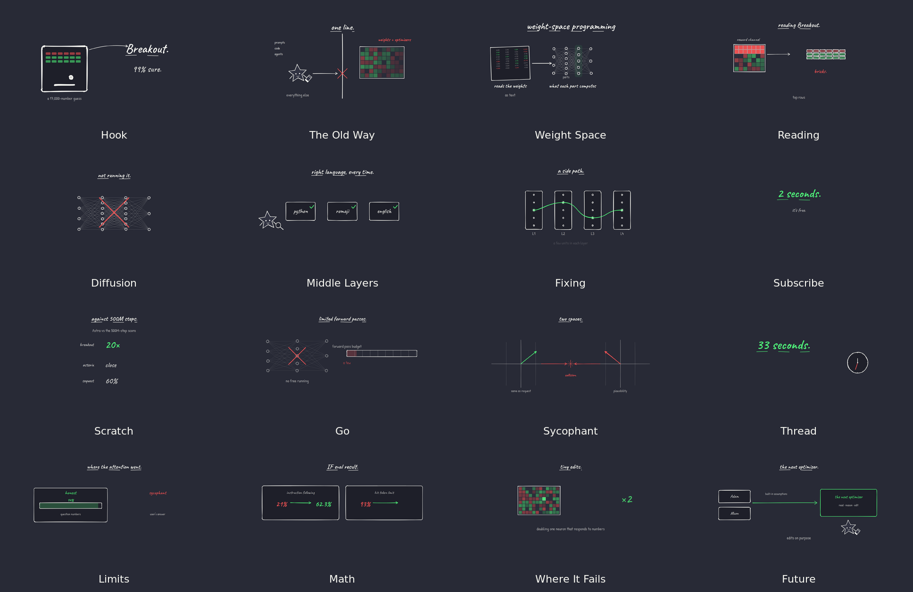

# Weight Space Programming

A 17:21 minimalist hand-drawn explainer about weight-space programming, rendered with Remotion and Rough.js.

**Visual language:** Dracula dark (`#282A36`), ink linework (`#F8F8F2`), red / green semantic accents, Caveat + Patrick Hand.



## Preview

- Contact sheet: `previews/contact-sheet.png`
- 16 chapter stills: `previews/cs01.png` … `previews/cs16.png`
- 2K preview still: `previews/2k-preview.png`

## Local development

```bash
npm install
npm run dev
```

Remotion Studio runs at `http://localhost:3000` by default.

## Render

1080p:

```bash
npm run render
```

2K QHD (2560×1440):

```bash
npx remotion render AstraWeightSpace out/astra-weight-space-2k.mp4 \
  --scale=1.3333333333333333 \
  --concurrency=4 \
  --gl=swangle \
  --crf=18 \
  --x264-preset=fast
```

Use `--frames=0-899` for a 30-second draft, or `--scale=0.5` for a fast look.

## Google Colab

[Open the 2K render notebook in Colab](https://colab.research.google.com/github/lroe/weight-space-programming/blob/main/AstraWeightSpace_Colab.ipynb)

Or open `AstraWeightSpace_Colab.ipynb` in Colab.

The notebook:

1. Mounts Google Drive first.
2. Installs Node.js, ffmpeg and Chromium libraries.
3. Loads this repository via git, then automatically falls back to the GitHub ZIP archive if cloning fails. Manual ZIP upload is the last resort.
4. Installs dependencies and Remotion's headless browser.
5. Renders 2560×1440 with live percentage, frame count and ETA.
6. Verifies the MP4 and copies it to `MyDrive/WeightSpaceProgramming/`.

Use a **CPU runtime**; a GPU does not accelerate Remotion's Chromium renderer.

## Project layout

```text
src/
  scenes/         16 chapter compositions
  components/     shared UI, diagrams, figures
  lib/            Rough.js primitives and timing helpers
  data/           word-level narration timings
  theme.ts        Dracula palette and global constants
public/
  audio.wav       narration
  fonts/          Caveat + Patrick Hand
scripts/
  stills.mjs      render preview stills by timestamp
```
